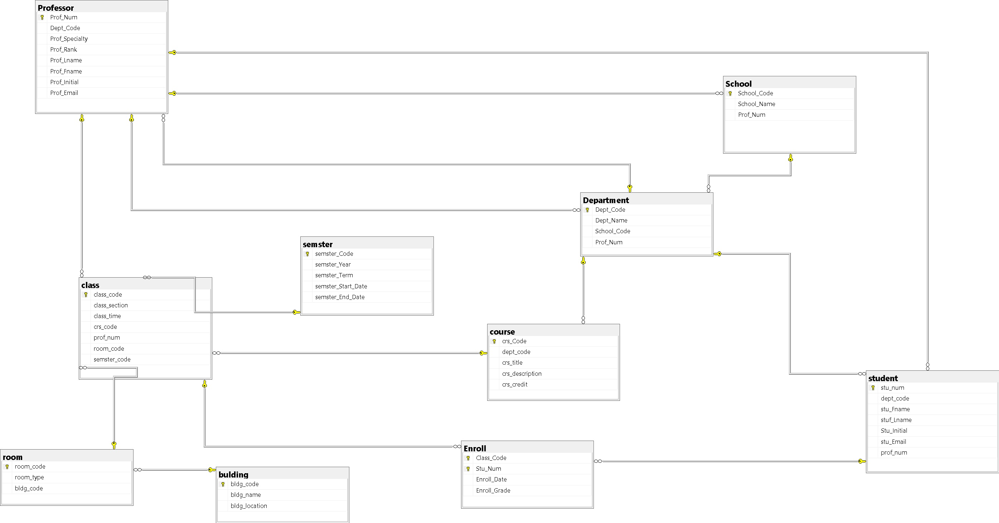

# 🎓 University Database Project


##  Summary

A relational database implementation for a University Management System.

---

## 💼 Business Value & Problem Statement

* **The Problem:** Universities frequently face disjointed academic data, leading to double-booked classrooms, inconsistent student records, and uncoordinated faculty workloads.


* **The Solution:** Architected and centralized core academic operations into a single, consistent source of truth, designed to:
  * **Prevent Scheduling & Capacity Conflicts:** By linking every class section to a specific semester, professor, and physical room (`class`, `semster`, `room`, `building`) to ensure accurate resource allocation.
  * **Streamline Student Lifecycle & Advising:** By tracking student departmental majors, assigned academic advisors, course enrollments, and final grades (`student`, `Enroll`, `Professor`) without data duplication.
  * **Enforce Academic Governance:** By maintaining clear structural accountability across university schools, departments, department chairs, and course catalogs (`School`, `Department`, `course`).

## 💻 Environment & Tools Specifications

| Component | Name / Edition | Version / Build |
| :--- | :--- | :--- |
| **Operating System** | Windows 11 Home (64-bit) | 23H2 (OS Build 22631) |
| **DBMS Engine** | Microsoft SQL Server 2022 | `16.0.1220.3` (Major: `16`, Minor: `0`, Build: `1220.3`) |
| **Engine Edition** | Enterprise Edition (Stand-alone instance) | Instance: `AHMEDZAKI\OLTP` |
| **Management Tool** | SQL Server Management Studio (SSMS) | v20.x |
| **Query Language** | Transact-SQL (T-SQL) | Compatibility Level `160` (SQL Server 2022) |

---

## 📂 Project Structure

```text
📦 University-Database
 ┣ 📜 University_Database.bak          # Full database backup (Tables + Data + Diagram)
 ┣ 📜 University_Database_Script.sql   # T-SQL script (Schema + Seed Data)
 ┣ 🖼️ Diagram.jpg                      # Entity-Relationship Diagram (ERD)
 ┗ 📖 README.md                        # Project documentation
```

---

## 🗺️ Entity-Relationship Diagram (ERD)



---

## 🧱 Database Schema (`dbo`)

| Table Name | Primary Key (PK) | Foreign Keys (FK) | Columns |
| :--- | :--- | :--- | :--- |
| **`School`** | `School_Code` | `Prof_Num` | `School_Code`, `School_Name`, `Prof_Num` |
| **`Department`** | `Dept_Code` | `School_Code`, `Prof_Num` | `Dept_Code`, `Dept_Name`, `School_Code`, `Prof_Num` |
| **`Professor`** | `Prof_Num` | `Dept_Code` | `Prof_Num`, `Dept_Code`, `Prof_Specialty`, `Prof_Rank`, `Prof_Lname`, `Prof_Fname`, `Prof_Initial`, `Prof_Email` |
| **`course`** | `crs_Code` | `dept_code` | `crs_Code`, `dept_code`, `crs_title`, `crs_description`, `crs_credit` |
| **`semster`** | `semster_Code` | *None* | `semster_Code`, `semster_Year`, `semster_Term`, `semster_Start_Date`, `semster_End_Date` |
| **`building`** | `bldg_code` | *None* | `bldg_code`, `bldg_name`, `bldg_location` |
| **`room`** | `room_code` | `bldg_code` | `room_code`, `room_type`, `bldg_code` |
| **`class`** | `class_code` | `crs_code`, `prof_num`, `room_code`, `semster_code` | `class_code`, `class_section`, `class_time`, `crs_code`, `prof_num`, `room_code`, `semster_code` |
| **`student`** | `stu_num` | `dept_code`, `prof_num` | `stu_num`, `dept_code`, `stu_fname`, `stuf_Lname`, `Stu_Initial`, `stu_Email`, `prof_num` |
| **`Enroll`** | `Class_Code`, `Stu_Num` | `Class_Code`, `Stu_Num` | `Class_Code`, `Stu_Num`, `Enroll_Date`, `Enroll_Grade` |

---

## 🚀 How to Run

1. **Using Backup (`.bak`):** Open **SSMS** --> Right-click **Databases** -->  **Restore Database** --> Select `University_Database.bak`.
2. **Using Script (`.sql`):** Open `University_Database_Script.sql` in **SSMS** --> Press **`F5`** (`Execute`).

